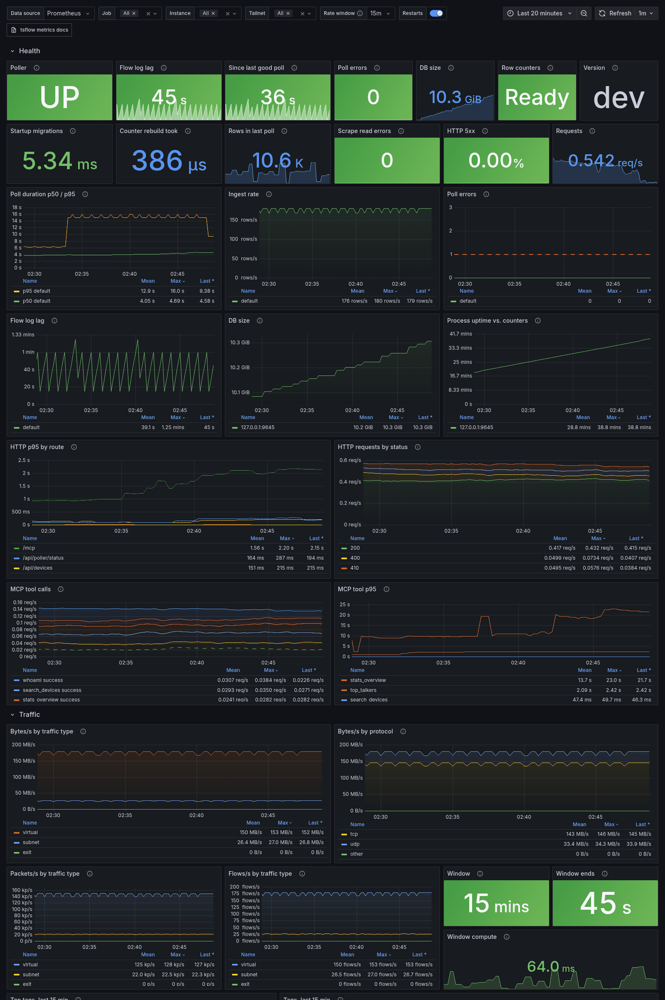

# Prometheus metrics

Set `TSFLOW_METRICS_ADDR` to serve metrics at `/metrics`:

```bash
TSFLOW_METRICS_ADDR=:9090
```

- Off unless set. Nothing is registered or timed without it.
- A bare port (`9090`) means every interface, same as `:9090`. Use `127.0.0.1:9090` to keep it local.
- It's its own plain HTTP listener that only answers `GET /metrics`. It never goes through access control, and in tsnet mode it isn't on the tailnet, so a cluster Prometheus can reach it the way probes reach `TSFLOW_HEALTH_PORT`.
- If you point it at the UI port (`TSFLOW_METRICS_ADDR=:8080` with the default `PORT`), `/metrics` is served on the main listener instead, outside `/api` and its access checks. Only do that if anyone who can reach the UI may also read the metrics.

## Metrics

Every `tailnet` label is the tailnet id from `TSFLOW_TAILNETS_FILE`, or `default`.

### Pollers

| Metric | Type | Labels | What it is |
|--------|------|--------|------------|
| `tsflow_poller_up` | gauge | `tailnet`, `backend` | 1 while the poll loop runs. `backend` is `api`, `s3` or `gcs`. |
| `tsflow_poller_last_success_timestamp_seconds` | gauge | `tailnet` | Unix time of the last successful poll, 0 before the first one. |
| `tsflow_poller_errors_total` | counter | `tailnet` | Failed polls since start. |
| `tsflow_poller_ingested_flow_logs_total` | counter | `tailnet` | Flow log rows ingested since start. |
| `tsflow_poller_last_poll_flow_logs` | gauge | `tailnet` | Rows in the latest poll. |
| `tsflow_poller_cursor_timestamp_seconds` | gauge | `tailnet` | Where the next poll starts. Missing before the first poll. |
| `tsflow_flow_newest_timestamp_seconds` | gauge | `tailnet` | Start of the newest stored minute. Missing when the tailnet has no data. |
| `tsflow_poll_duration_seconds` | histogram | `tailnet`, `result` | Time per poll. `result` is `success` or `error`. |

### Storage and startup

| Metric | Type | What it is |
|--------|------|------------|
| `tsflow_db_size_bytes` | gauge | The SQLite file plus its `-wal` and `-shm` files. |
| `tsflow_db_init_duration_seconds` | gauge | Time the startup migrations and rollup backfills took. |
| `tsflow_pair_row_counters_ready` | gauge | 0 while the per-minute pair row counters rebuild in the background after an upgrade, 1 when done. |
| `tsflow_pair_row_counters_build_duration_seconds` | gauge | How long that rebuild took. 0 until it finishes. |

### HTTP and MCP

| Metric | Type | Labels | What it is |
|--------|------|--------|------------|
| `tsflow_http_request_duration_seconds` | histogram | `route`, `method`, `code` | Latency per request. `route` is the route template, like `/api/devices/:deviceId/flows`, never the raw path. UI pages and unmatched paths share `route="other"`. |
| `tsflow_mcp_tool_calls_total` | counter | `tool`, `result` | MCP tool calls. A name no tool answers to counts as `tool="unknown"`. |
| `tsflow_mcp_tool_duration_seconds` | histogram | `tool` | MCP tool latency. |

### Process

| Metric | What it is |
|--------|------------|
| `tsflow_build_info{version,goversion}` | Always 1. |
| `tsflow_metrics_collect_errors_total` | Store reads that failed during a scrape. |
| `go_*`, `process_*` | The standard Go runtime and process collectors. |

A scrape reads poller state from memory, two single-row lookups per tailnet, and a file stat. It adds nothing to the poll or request path beyond one histogram observation.

## Traffic metrics

`TSFLOW_METRICS_TRAFFIC=true` adds traffic. It's off by default, separate from the health metrics above, and needs `TSFLOW_METRICS_ADDR`.

### Counters

Added once per poll from the aggregates the poller already built, so `rate()` works the usual way. Bytes are counted once, by the sender, like the rest of tsflow. They're counted when they're ingested, so a backfill after downtime shows up as a spike at ingest time, not spread over the hours it covers.

| Metric | Labels | What it is |
|--------|--------|------------|
| `tsflow_traffic_bytes_total` | `tailnet`, `traffic_type` | Bytes. `traffic_type` is `virtual`, `subnet`, `exit` or `physical`. |
| `tsflow_traffic_packets_total` | `tailnet`, `traffic_type` | Packets. |
| `tsflow_traffic_flows_total` | `tailnet`, `traffic_type` | Flow records. |
| `tsflow_traffic_protocol_bytes_total` | `tailnet`, `protocol` | Bytes by `tcp`, `udp` or `other`, not counting physical transport. |

Physical traffic is the WireGuard transport underneath the other three, so add `traffic_type!="physical"` when you want what users sent.

### Last 15 minutes

Breakdowns are gauges over the last 15 minutes of ingested data, read from the in-memory cache on scrape and kept for 30 seconds. The newest minute is still being filled by later polls, so the window ends at its start. Physical transport is left out.

| Metric | Labels | What it is |
|--------|--------|------------|
| `tsflow_tag_traffic_bytes`, `tsflow_tag_traffic_packets` | `tailnet`, `tag`, `direction` | Sent (`tx`) and received (`rx`) by devices with each tag. The top 20 tags, then `other`, plus `untagged` and `unknown` (addresses that aren't a tailnet device). A device with two tags counts in both. |
| `tsflow_user_traffic_bytes`, `tsflow_user_traffic_packets` | `tailnet`, `user`, `direction` | The same by device owner. Tagged devices are owned by `tagged-devices`. |
| `tsflow_port_traffic_bytes` | `tailnet`, `protocol`, `port` | The top 20 service ports, then `protocol="other",port="other"` for the rest. |
| `tsflow_traffic_window_seconds` | `tailnet` | How much data is behind the gauges. Below 900 for the first 15 minutes after a start. |
| `tsflow_traffic_window_end_timestamp_seconds` | `tailnet` | Where the window ends. |
| `tsflow_traffic_window_compute_seconds` | | How long the last computation took. |

The top-N cutoffs keep the series count the same at 20 devices or 20,000: about 200 traffic series per tailnet.

### Top talkers

`TSFLOW_METRICS_TOP_TALKERS=20` adds `tsflow_top_talker_bytes{tailnet,node,node_id,direction}` for the 20 devices that moved the most bytes in the same window, up to 100. It's the only metric with a per-device label. Which devices are listed changes as traffic does, so read it as a current ranking, not a history per device.

## Grafana dashboard

[`k8s/monitoring/tsflow-dashboard.json`](../k8s/monitoring/tsflow-dashboard.json) covers all of the above. It works with Grafana 10 and 11 and a Prometheus data source.



- **Health:** poller up, flow log lag, time since the last good poll, poll duration p50/p95, poll errors, ingest rate, DB size, migration and row-counter rebuild status, HTTP p95 by route, status codes and 5xx share, and MCP calls and latency.
- **Traffic:** bytes, packets and flows per second by traffic type and protocol. Top tags, users and ports as bar gauges and tables. Top talkers. Window freshness.
- **Runtime:** CPU, memory, goroutines, GC, allocations and file descriptors.

The variables at the top are the data source, `job`, `instance`, `tailnet` (multi-select) and a rate window. Counters move once per poll, so keep the window at two or three times `TSFLOW_POLL_INTERVAL`. The default is 15m. The traffic row needs `TSFLOW_METRICS_TRAFFIC=true`, the top talkers panels need `TSFLOW_METRICS_TOP_TALKERS`, and the MCP panels need `TSFLOW_MCP_ENABLED=true`. Panels for a feature that's off say so instead of showing an error.

To import it by hand:

1. In Grafana, go to **Dashboards → New → Import**.
2. Upload `tsflow-dashboard.json` or paste its contents, then click **Import**.
3. Pick your Prometheus data source from the **Data source** dropdown at the top of the dashboard. It starts on your default one. Nothing in the JSON hardcodes a data source.

To provision it from a file, point a dashboard provider at the folder that holds the JSON:

```yaml
# grafana/provisioning/dashboards/tsflow.yaml
apiVersion: 1
providers:
  - name: tsflow
    type: file
    options:
      path: /var/lib/grafana/dashboards/tsflow
```

On Kubernetes with the Grafana sidecar (kube-prometheus-stack or the grafana Helm chart), `kubectl apply -k k8s/monitoring` creates a `tsflow-grafana-dashboard` ConfigMap labeled `grafana_dashboard: "1"` along with the alert rules below. Apply it in a namespace the sidecar watches. It's separate from `k8s/kustomization.yaml`, so the main deploy doesn't need the Prometheus Operator CRDs.

## Alert examples

[`k8s/monitoring/prometheusrule.yaml`](../k8s/monitoring/prometheusrule.yaml) has these and a few more as a `PrometheusRule`: poller down, stale flow logs, no successful poll, failing polls, 5xx share, metrics read errors and a stuck counter rebuild.

```yaml
groups:
  - name: tsflow
    rules:
      - alert: TsflowFlowLogsStale
        # No new flow data for 30 minutes. With the API backend the newest
        # minute trails now by TSFLOW_POLL_DELAY plus the poll interval.
        expr: time() - tsflow_flow_newest_timestamp_seconds > 1800
        for: 10m
      - alert: TsflowPollsFailing
        expr: increase(tsflow_poller_errors_total[30m]) > 3
      - alert: TsflowNoSuccessfulPoll
        expr: time() - tsflow_poller_last_success_timestamp_seconds > 3 * 300
        for: 5m
```

## Kubernetes

Add the port to the container and the Service, then scrape it with a `ServiceMonitor` (Prometheus Operator) or the usual annotations.

```yaml
# Deployment container
env:
  - name: TSFLOW_METRICS_ADDR
    value: ":9090"
ports:
  - name: metrics
    containerPort: 9090
---
apiVersion: v1
kind: Service
metadata:
  name: tsflow-metrics
  labels:
    app: tsflow
  annotations:
    prometheus.io/scrape: "true"
    prometheus.io/port: "9090"
spec:
  selector:
    app: tsflow
  ports:
    - name: metrics
      port: 9090
      targetPort: metrics
---
apiVersion: monitoring.coreos.com/v1
kind: ServiceMonitor
metadata:
  name: tsflow
spec:
  selector:
    matchLabels:
      app: tsflow
  endpoints:
    - port: metrics
      interval: 30s
```
